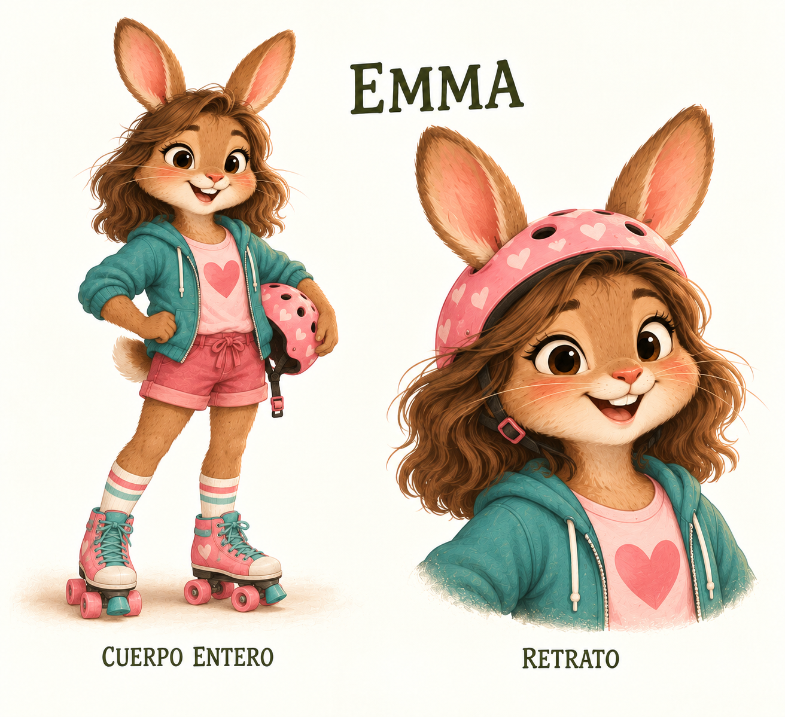
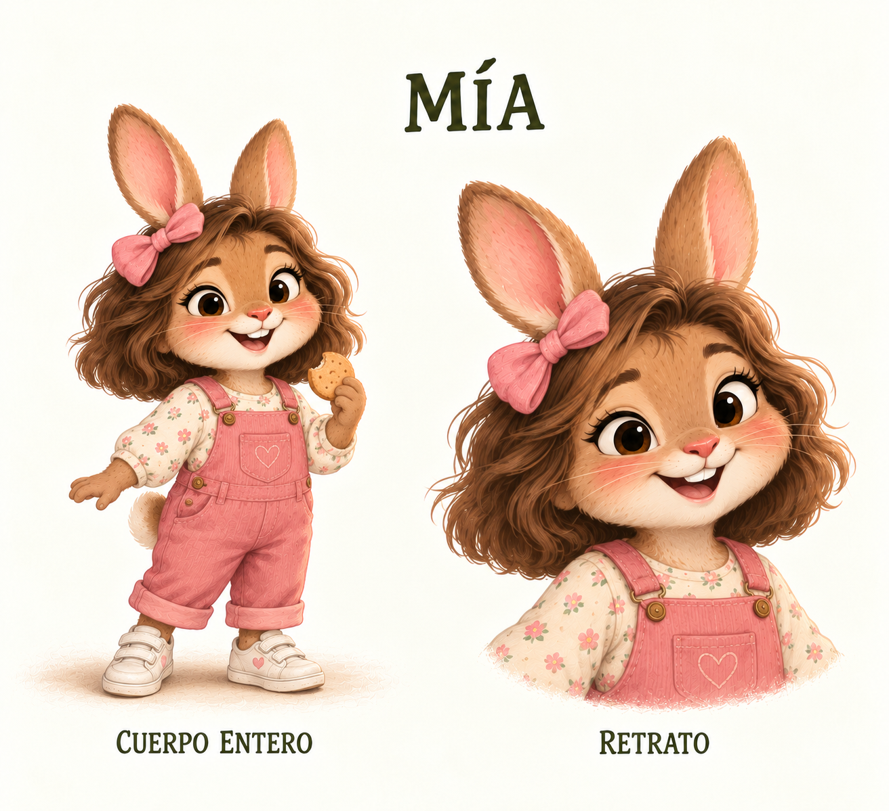
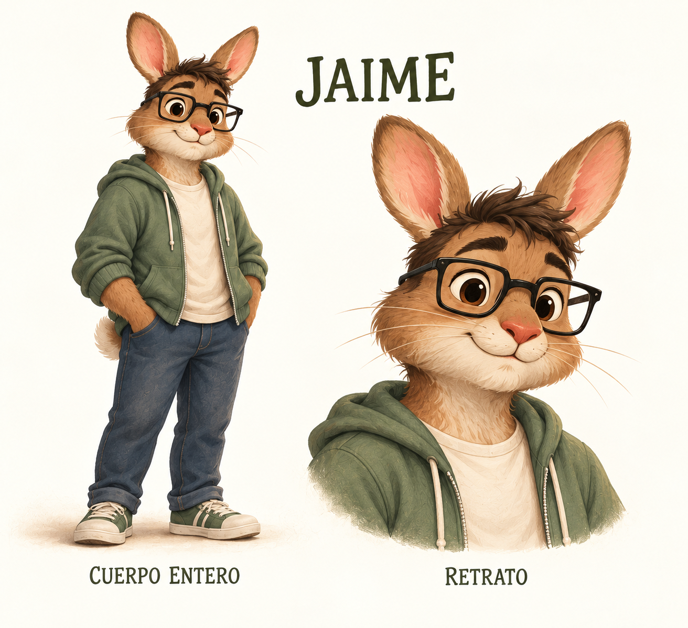
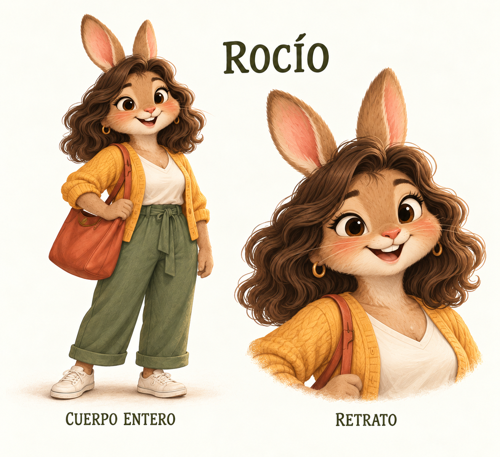

# Mi familia

Me llamo Emma. Me encanta patinar y dibujar, aunque a veces dejo los lápices en sitios tan raros que luego tengo que pedir ayuda para encontrarlos. El otro día apareció uno dentro de un patín. Todavía no sé cómo llegó allí.

Mi hermana pequeña, Mía, quiere colorear a mi lado y patinar como yo. A veces discutimos por el mismo lápiz. Después ella me enseña su dibujo, yo le enseño el mío y volvemos a ser un equipo. Si hay galletas, Mía siempre se entera la primera.

Papá Jaime trabaja con ordenadores y suele estar ocupado. Pero, cuando algo se atasca, viene a echar una mano. También va al gimnasio. Dice que cargar con Mía cuando se queda dormida cuenta como entrenamiento extra.

Mamá Rocío suele hablar con mucha calma. Hasta que ve migas por todo el sofá: «¡Pero bueno!». Mía y yo nos miramos sin decir nada. Mamá suspira… y al final acabamos las tres recogiendo miguitas entre risas.

Así somos en mi casa: a veces discutimos, a veces nos reímos y casi siempre alguien pregunta dónde está algo. Si es un lápiz, quizá debería mirar primero en mis patines.

**Para conversar:** ¿Qué cosa divertida pasa a menudo en tu familia?
